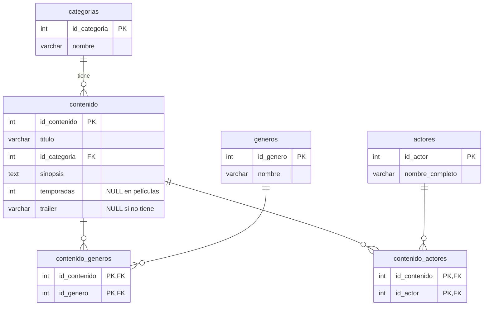

# Trailerflix

### Entrega final

**Equipo N° 14**: Milagros Fuentes y Alejo Petricio

---

API REST y servidor web hechos con **Express**. Exponen un catálogo de películas y series guardado en **MySQL**, al que se accede con el ORM **Sequelize**. La ruta raíz muestra una página de bienvenida hecha con **EJS**. Los endpoints de la API responden en JSON y permiten **leer, crear, modificar y eliminar** contenido.

El endpoint principal (`/catalogo`) devuelve los datos con **la misma estructura que el archivo JSON original** (`database/trailerflix.json`). Esa estructura se arma desde JavaScript a partir de los modelos.

## Dependencias principales

| Dependencia | Versión         | Descripción                                   |
| ----------- | --------------- | --------------------------------------------- |
| `express`   | ^5.2.1          | Framework del servidor web y enrutamiento     |
| `sequelize` | ^6.37.8         | ORM para trabajar con la base de datos        |
| `mysql2`    | ^3.24.6         | Driver de MySQL que usa Sequelize             |
| `dotenv`    | ^17.4.2         | Carga de variables de entorno desde `.env`    |
| `ejs`       | ^3.1.10         | Motor de plantillas para las vistas HTML      |
| `nodemon`   | ^3.1.14 _(dev)_ | Recarga automática del servidor en desarrollo |

Sequelize y mysql2 se instalaron con:

```bash
npm install --save sequelize
npm install --save mysql2
```

## Prerrequisitos

- [Node.js](https://nodejs.org/) v18 o superior, y npm.
- **MySQL** 8 (o compatible) en ejecución, con un usuario que pueda leer y escribir en la base `trailerflix`.

## Base de datos

La base se crea y se carga con dos scripts SQL, que se ejecutan **en este orden** (desde MySQL Workbench o la consola):

0. Crear la base vacía (el script de creación no la crea):

   ```sql
   CREATE DATABASE trailerflix CHARACTER SET utf8mb4 COLLATE utf8mb4_unicode_ci;
   ```

1. `database/trailerflix.sql`: crea las 6 tablas y sus claves foráneas.
2. `database/insert_data.sql`: inserta las categorías, los 13 géneros, los 139 actores, los 30 títulos y sus relaciones.

```bash
mysql -u root -p trailerflix < database/trailerflix.sql
mysql -u root -p trailerflix < database/insert_data.sql
```

> La collation `utf8mb4_unicode_ci` es importante: gracias a ella las búsquedas ignoran tildes y mayúsculas.

> La aplicación **no modifica la estructura** de la base: no usa `sync()` ni crea tablas. Solo lee y escribe datos.

## Instalación y ejecución

```bash
# 1. Clonar el repositorio
git clone <repo-url>
cd trailerflix

# 2. Instalar dependencias
npm install

# 3. Crear el archivo de variables de entorno y completar los datos de MySQL
copy .env.example .env    # Windows
# cp .env.example .env    # Linux / macOS

# 4. Ejecutar el servidor
npm run dev               # desarrollo (nodemon)
# o
npm start                 # producción (node)
```

Al iniciar, primero se verifica la conexión a MySQL (`Conexión a MySQL establecida correctamente.`). **Si la conexión falla, el servidor no se levanta.** Al detenerlo con `Ctrl+C`, se cierra la conexión (`Conexión cerrada correctamente.`).

El servidor queda disponible en **http://localhost:3008**.

## Variables de entorno

El archivo `.env` no se sube al repositorio porque figura en `.gitignore`. Usá `.env.example` como plantilla.

| Variable      | Ejemplo       | Descripción                         |
| ------------- | ------------- | ----------------------------------- |
| `PORT`        | `3008`        | Puerto de escucha del servidor web  |
| `DB_HOST`     | `localhost`   | Host de MySQL                       |
| `DB_PORT`     | `3306`        | Puerto de MySQL                     |
| `DB_USER`     | `root`        | Usuario de MySQL                    |
| `DB_PASSWORD` | `****`        | Contraseña de MySQL                 |
| `DB_NAME`     | `trailerflix` | Nombre de la base de datos          |

## Estructura del proyecto

```
trailerflix/
├── .env                      # Variables de entorno (no se sube a git)
├── .env.example              # Plantilla de variables de entorno
├── .gitignore
├── package.json
├── package-lock.json
├── server.js                 # Servidor Express + endpoints de la API
├── config/
│   └── db.js                 # Conexión Sequelize, testConnection() y closeConnection()
├── models/
│   ├── index.js              # Asociaciones entre modelos
│   ├── Categoria.js
│   ├── Genero.js
│   ├── Actor.js
│   ├── Contenido.js
│   ├── ContenidoGenero.js
│   └── ContenidoActor.js
├── utils/
│   └── formatearContenido.js # Arma cada registro con el formato del JSON original
├── database/
│   ├── trailerflix.sql       # Script de creación de las tablas
│   ├── insert_data.sql       # Script de carga de datos
│   └── trailerflix.json      # JSON original (solo como referencia)
└── views/
    ├── index.ejs             # Página de bienvenida
    ├── 404.ejs               # Página de ruta no encontrada
    └── partials/
        ├── head.ejs
        ├── navbar.ejs
        └── footer.ejs
```

## Modelos y relaciones

Cada modelo de `/models` corresponde a una tabla y sus campos tienen el mismo nombre que las columnas.

| Modelo            | Tabla               | Campos                                                                     |
| ----------------- | ------------------- | -------------------------------------------------------------------------- |
| `Categoria`       | `categorias`        | `id_categoria` (PK, autoincremental), `nombre`                             |
| `Genero`          | `generos`           | `id_genero` (PK, autoincremental), `nombre`                                |
| `Actor`           | `actores`           | `id_actor` (PK, autoincremental), `nombre_completo`                        |
| `Contenido`       | `contenido`         | `id_contenido` (PK), `titulo`, `id_categoria` (FK), `sinopsis`, `temporadas`, `trailer` |
| `ContenidoGenero` | `contenido_generos` | `id_contenido` + `id_genero` (PK compuesta)                                |
| `ContenidoActor`  | `contenido_actores` | `id_contenido` + `id_actor` (PK compuesta)                                 |

Relaciones definidas en `models/index.js`:

- `Categoria.hasMany(Contenido)` / `Contenido.belongsTo(Categoria)`
- `Contenido.belongsToMany(Genero)` / `Genero.belongsToMany(Contenido)` a través de `contenido_generos`
- `Contenido.belongsToMany(Actor)` / `Actor.belongsToMany(Contenido)` a través de `contenido_actores`



### Normalización del JSON a 6 tablas

En el JSON original cada título era un objeto con todo junto: la categoría como texto, y los géneros y el reparto como textos separados por coma. Al pasarlo a MySQL se normalizó así:

- **categoria** pasó a la tabla `categorias`, y `contenido.id_categoria` la referencia.
- **genero** se separó en la tabla `generos`. La relación muchos a muchos con `contenido` se guarda en `contenido_generos`.
- **reparto** se separó en la tabla `actores`. La relación muchos a muchos se guarda en `contenido_actores`.
- `"N/A"` en **temporadas** se guarda como `NULL`.
- Un **trailer** ausente se guarda como `NULL`.

La función `utils/formatearContenido.js` hace el camino inverso. Toma un `Contenido` con su `Categoria`, sus `Generos` y sus `Actores`, y devuelve un objeto con las claves del JSON original (`id, titulo, categoria, genero, sinopsis, temporadas, reparto, trailer`). Los géneros y el reparto quedan unidos con `", "`. `NULL` en temporadas se muestra como `"N/A"`, y si no hay trailer, la clave se omite. Todos los endpoints de contenido usan esta función.

> **Orden de géneros y reparto:** las tablas intermedias no guardan la posición de cada género o actor. Por eso se ordenan por su id (`id_genero` / `id_actor`), y en algunos títulos ese orden no coincide con el del JSON original. Por ejemplo, en *Enola Holmes* aparece `"Misterio, Aventura, Comedia"` en lugar de `"Aventura, Misterio, Comedia"`. Los datos son los mismos, solo cambia el orden.

> **id_contenido:** en la tabla `contenido` esta columna **no es AUTO_INCREMENT**, y la base no se modifica. Por eso, al crear un contenido, el id nuevo se calcula en JavaScript como el máximo actual más 1, dentro de la misma transacción.

## Documentación de la API

Todas las respuestas de la API son **JSON**. Los errores siempre tienen la forma `{ "error": "..." }`.

| Método | Ruta               | Descripción                                    |
| ------ | ------------------ | ---------------------------------------------- |
| GET    | `/`                | Página de bienvenida (HTML)                    |
| GET    | `/catalogo`        | Todo el catálogo (formato del JSON original)   |
| GET    | `/titulo/:title`   | Busca por título (búsqueda parcial)            |
| GET    | `/categoria/:cat`  | Filtra por categoría (`serie` o `pelicula`)    |
| GET    | `/reparto/:act`    | Busca por actor/actriz (búsqueda parcial)      |
| GET    | `/trailer/:id`     | Devuelve el tráiler por ID                     |
| GET    | `/contenido`       | Listado de contenido                           |
| GET    | `/contenido/:id`   | Un contenido por ID                            |
| POST   | `/contenido`       | Crea un contenido                              |
| PUT    | `/contenido/:id`   | Modifica un contenido                          |
| DELETE | `/contenido/:id`   | Elimina un contenido                           |

Cualquier endpoint puede responder `500` si falla la base de datos, por ejemplo `{ "error": "Error al obtener el contenido" }`. El mensaje cambia según la operación.

---

### `GET /`

Página de bienvenida en HTML con el total de títulos, películas y series de la base.

**Respuesta:** `200 OK` (HTML)

---

### `GET /catalogo`

Lista todo el catálogo, ordenado por id y con la misma estructura del JSON original.

**Ejemplo:** `GET http://localhost:3008/catalogo`

**Respuesta:** `200 OK`

```json
[
  {
    "id": 1,
    "titulo": "The Crown",
    "categoria": "Serie",
    "genero": "Drama, Hechos verídicos",
    "sinopsis": "Recorre el reinado de Isabel II desde su juventud...",
    "temporadas": 6,
    "reparto": "Claire Foy, Olivia Colman, Imelda Staunton...",
    "trailer": "https://www.youtube.com/results?search_query=The+Crown+trailer+oficial"
  }
]
```

**Parámetros opcionales (query string).** Sin parámetros devuelve todo.

| Parámetro   | Ejemplo               | Descripción                                    |
| ----------- | --------------------- | ---------------------------------------------- |
| `categoria` | `?categoria=pelicula` | Filtra por categoría (ignora tildes/mayúsculas) |
| `orden`     | `?orden=titulo`       | `titulo` (alfabético) o `id` (por defecto)     |
| `limit`     | `?limit=5`            | Cantidad máxima de resultados                  |
| `offset`    | `?offset=10`          | Cantidad de resultados a saltear               |

**Ejemplo:** `GET http://localhost:3008/catalogo?categoria=serie&orden=titulo&limit=5&offset=0`

**Errores:**

- `400` `{ "error": "Orden inválido. Los valores aceptados son titulo o id." }`
- `400` `{ "error": "Los parámetros limit y offset deben ser números enteros (limit mayor a 0)." }`
- `404` `{ "error": "Oops...Ocurrio un problema" }` (sin resultados)

---

### `GET /titulo/:title`

Lista el contenido cuyo título contiene el texto enviado. Es una búsqueda **parcial** con `Op.like` y `%texto%` que ignora mayúsculas y tildes (por la collation `utf8mb4_unicode_ci`).

**Ejemplo:** `GET http://localhost:3008/titulo/holmes`

**Respuesta:** `200 OK`

```json
{
  "resultados": [
    {
      "id": 6,
      "titulo": "Enola Holmes",
      "categoria": "Película",
      "genero": "Misterio, Aventura, Comedia",
      "sinopsis": "La hermana menor de Sherlock Holmes decide buscar por su cuenta a su madre desaparecida...",
      "temporadas": "N/A",
      "reparto": "Millie Bobby Brown, Henry Cavill, Sam Claflin, Helena Bonham Carter",
      "trailer": "https://www.youtube.com/results?search_query=Enola+Holmes+trailer+oficial"
    }
  ]
}
```

**Sin coincidencias:** `404` `{ "error": "No hubo coincidencias en la busqueda." }`

---

### `GET /categoria/:cat`

Lista el contenido de la categoría enviada. Las categorías válidas son `serie` y `pelicula`, sin distinguir mayúsculas ni tildes.

**Ejemplo:** `GET http://localhost:3008/categoria/serie`

**Respuesta:** `200 OK` con `{ "resultados": [ ... ] }`, con el mismo formato que `/catalogo`.

**Errores:**

- `400` `{ "error": "Categoría inválida. Los únicos parámetros aceptados son serie o pelicula." }`
- `404` `{ "error": "No se encontró contenido para la categoría: serie" }`

---

### `GET /reparto/:act`

Lista los títulos en los que actúa la actriz o el actor indicado. La búsqueda es **parcial** e ignora mayúsculas y tildes. Se devuelve el **reparto completo** de cada título.

**Ejemplo:** `GET http://localhost:3008/reparto/pedro pascal`

**Respuesta:** `200 OK`

```json
{
  "resultados": [
    {
      "titulo": "The Mandalorian",
      "reparto": "Pedro Pascal, Gina Carano, Giancarlo Esposito, Carl Weathers, Katee Sackhoff"
    }
  ]
}
```

**Sin coincidencias:** `404` `{ "error": "No se encontraron producciones con ese actor." }`

---

### `GET /trailer/:id`

Devuelve el id, el título y el tráiler del contenido.

**Ejemplo:** `GET http://localhost:3008/trailer/1`

```json
{
  "id": 1,
  "titulo": "The Crown",
  "trailer": "https://www.youtube.com/results?search_query=The+Crown+trailer+oficial"
}
```

**Sin tráiler** (`GET /trailer/5`): `200 OK`

```json
{
  "id": 5,
  "titulo": "Gambito de Dama",
  "trailer": "Este título no tiene un trailer disponible."
}
```

**Errores:**

- `400` `{ "error": "El id debe ser un valor numérico." }`
- `404` `{ "error": "No existe ninguna película o serie con el id 999." }`

---

### `GET /contenido`

Lista todo el contenido con el mismo formato que `/catalogo`.

**Respuesta:** `200 OK` con `[ ... ]`

---

### `GET /contenido/:id`

Devuelve un contenido por su id.

**Ejemplo:** `GET http://localhost:3008/contenido/3`

**Respuesta:** `200 OK` con un objeto con el formato del JSON original.

**Errores:**

- `400` `{ "error": "El id debe ser un valor numérico." }`
- `404` `{ "error": "Contenido no encontrado" }`

---

### `POST /contenido`

Crea un contenido. El body usa el formato del JSON original **sin `id`**, porque el id se genera automáticamente.

- `titulo`, `categoria` y `sinopsis` son obligatorios.
- `categoria` puede ser `Serie` o `Película`, sin importar mayúsculas ni tildes (`pelicula` también sirve).
- `genero` y `reparto` son textos separados por coma. Si un género o un actor no existe, se crea (`findOrCreate`).
- `temporadas` es un número entero, o `"N/A"` (se guarda `NULL`). Es opcional.
- `trailer` es opcional.

Todo el alta se hace dentro de una **transacción**: si algo falla, no se guarda nada.

**Ejemplo:** `POST http://localhost:3008/contenido` con header `Content-Type: application/json`

```json
{
  "titulo": "Nueve Reinas",
  "categoria": "Pelicula",
  "genero": "Drama, Suspenso",
  "sinopsis": "Dos estafadores se cruzan por casualidad y planean el golpe de sus vidas con unas estampillas falsas.",
  "temporadas": "N/A",
  "reparto": "Ricardo Darín, Gastón Pauls, Leticia Brédice",
  "trailer": "https://www.youtube.com/results?search_query=Nueve+Reinas+trailer"
}
```

**Respuesta:** `201 Created`

```json
{
  "id": 31,
  "titulo": "Nueve Reinas",
  "categoria": "Película",
  "genero": "Drama, Suspenso",
  "sinopsis": "Dos estafadores se cruzan por casualidad y planean el golpe de sus vidas con unas estampillas falsas.",
  "temporadas": "N/A",
  "reparto": "Ricardo Darín, Gastón Pauls, Leticia Brédice",
  "trailer": "https://www.youtube.com/results?search_query=Nueve+Reinas+trailer"
}
```

**Errores:**

- `400` `{ "error": "Los campos titulo, categoria y sinopsis son obligatorios." }`
- `400` `{ "error": "Categoría inválida. Los únicos valores aceptados son Serie o Película." }`
- `400` `{ "error": "Los campos genero y reparto deben ser textos separados por coma." }`
- `400` `{ "error": "El campo temporadas debe ser un número entero o \"N/A\"." }`
- `400` `{ "error": "El body debe ser un JSON válido." }`
- `409` `{ "error": "Ya existe un contenido con ese título." }`
- `500` `{ "error": "Error al crear el contenido" }`

---

### `PUT /contenido/:id`

Modifica un contenido. Solo se envían los campos que cambian; **los que no vienen conservan su valor**. Si vienen `genero` o `reparto`, **reemplazan** las relaciones anteriores. Se ejecuta en una transacción.

**Ejemplo:** `PUT http://localhost:3008/contenido/31`

```json
{
  "sinopsis": "Nueva sinopsis.",
  "reparto": "Ricardo Darín, Gastón Pauls"
}
```

**Respuesta:** `200 OK` con el contenido actualizado (formato del JSON original).

**Errores:**

- `400` `{ "error": "El id debe ser un valor numérico." }`
- `400` `{ "error": "Los campos titulo, categoria y sinopsis no pueden quedar vacíos." }`
- `400` `{ "error": "Categoría inválida. Los únicos valores aceptados son Serie o Película." }`
- `400` Las mismas validaciones de `genero`, `reparto`, `temporadas` y JSON que en el POST.
- `404` `{ "error": "Contenido no encontrado" }`
- `409` `{ "error": "Ya existe un contenido con ese título." }`
- `500` `{ "error": "Error al actualizar el contenido" }`

---

### `DELETE /contenido/:id`

Elimina el contenido y sus filas en `contenido_generos` y `contenido_actores`, dentro de una transacción. **No elimina géneros ni actores**, porque pueden pertenecer a otros títulos.

**Ejemplo:** `DELETE http://localhost:3008/contenido/31`

**Respuesta:** `200 OK`

```json
{ "message": "Contenido eliminado correctamente" }
```

**Errores:**

- `400` `{ "error": "El id debe ser un valor numérico." }`
- `404` `{ "error": "Contenido no encontrado" }`
- `500` `{ "error": "Error al eliminar el contenido" }`

---

### Rutas inexistentes

Cualquier ruta que no esté definida responde con la página HTML de error **404**.

## Notas

- Las búsquedas usan `Op.like` y la collation `utf8mb4_unicode_ci` de MySQL. Por eso ignoran tildes y mayúsculas: `Película`, `pelicula` y `PELÍCULA` son iguales, y `guason` encuentra "Guasón".
- `database/trailerflix.json` ya no se lee desde el código. Queda en el proyecto solo como referencia del formato original.
- El archivo `.env` y la carpeta `node_modules/` están excluidos de git mediante `.gitignore`.
